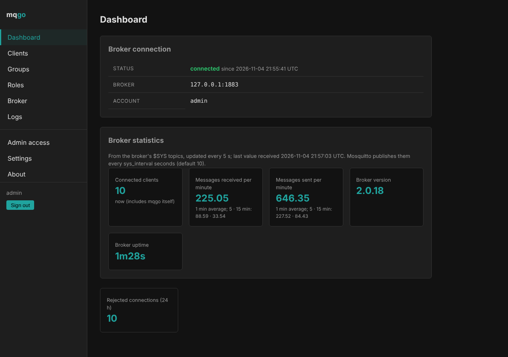
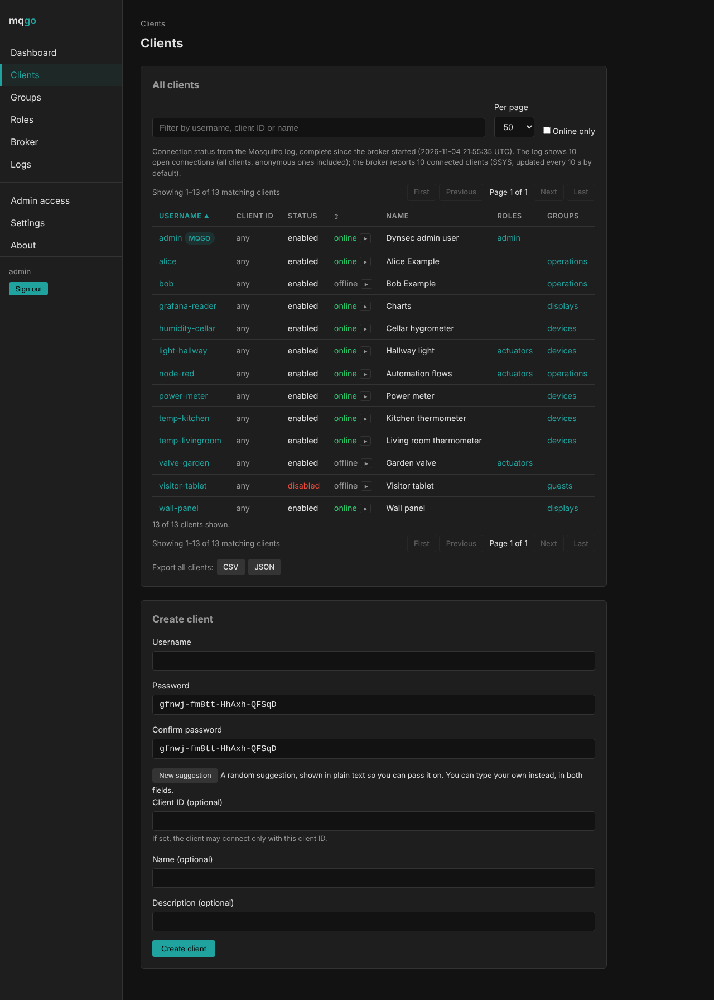
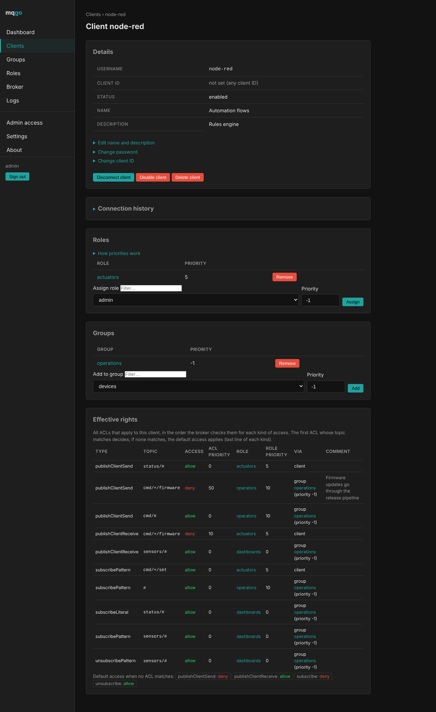
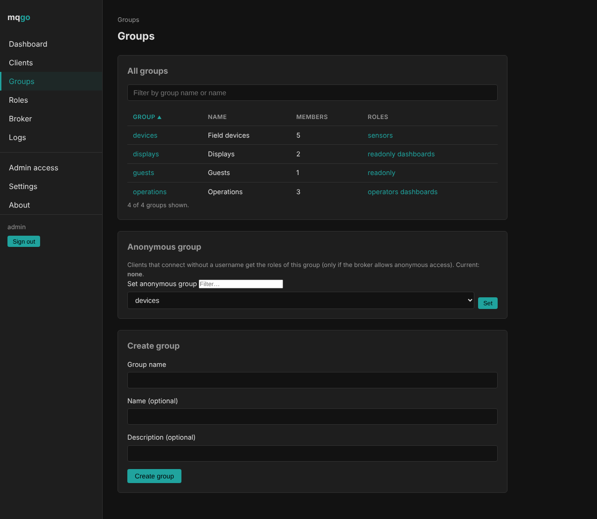
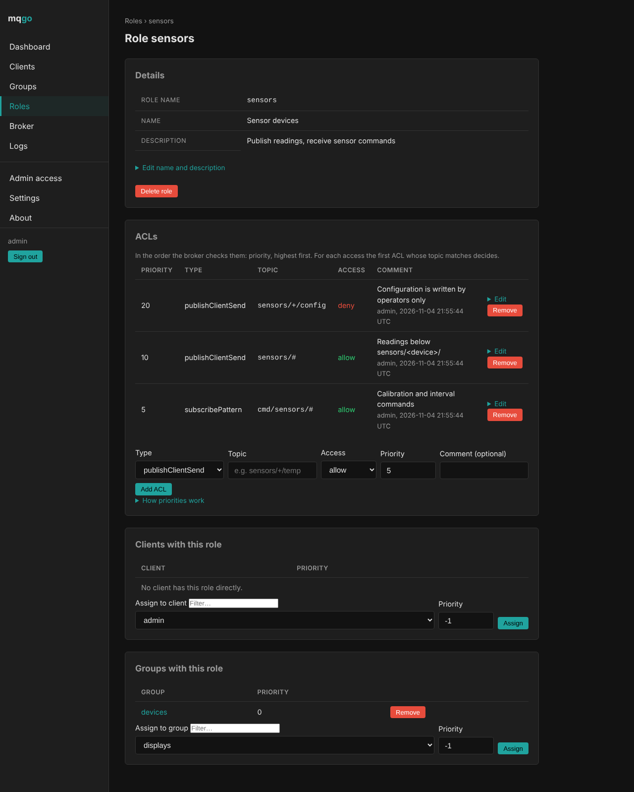
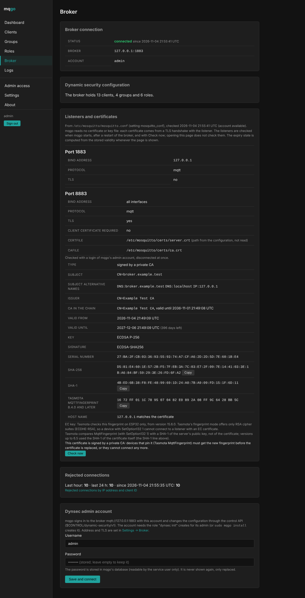
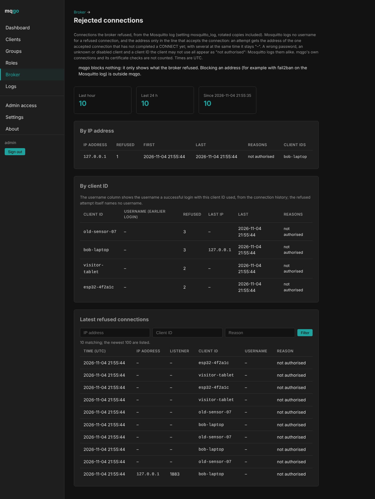
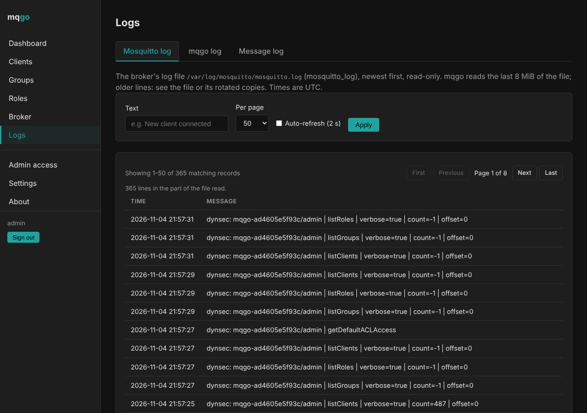
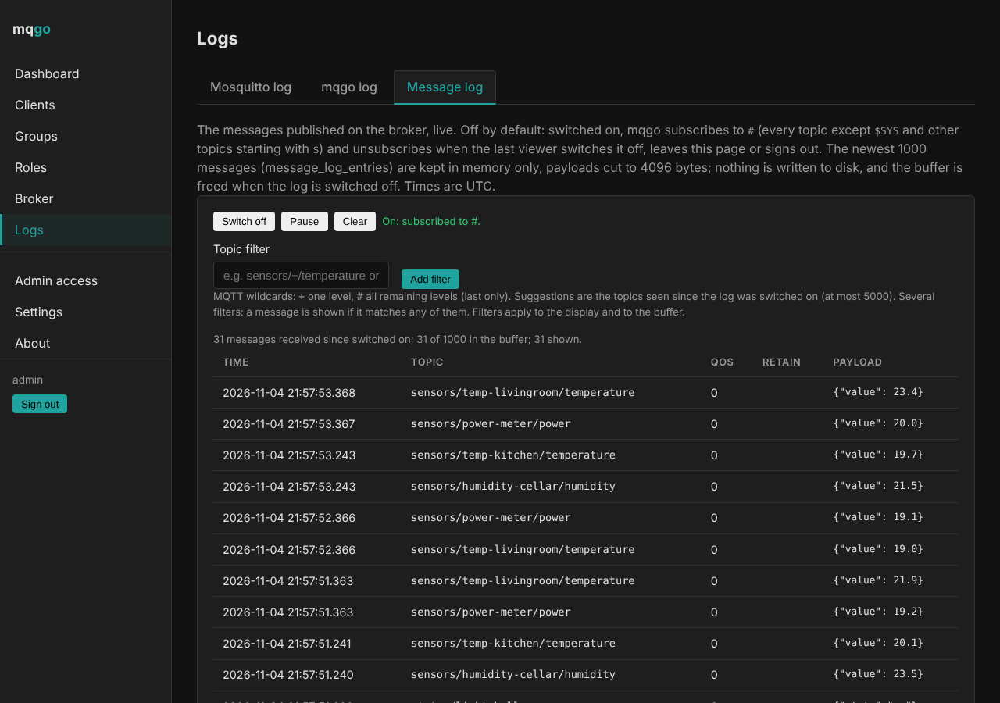
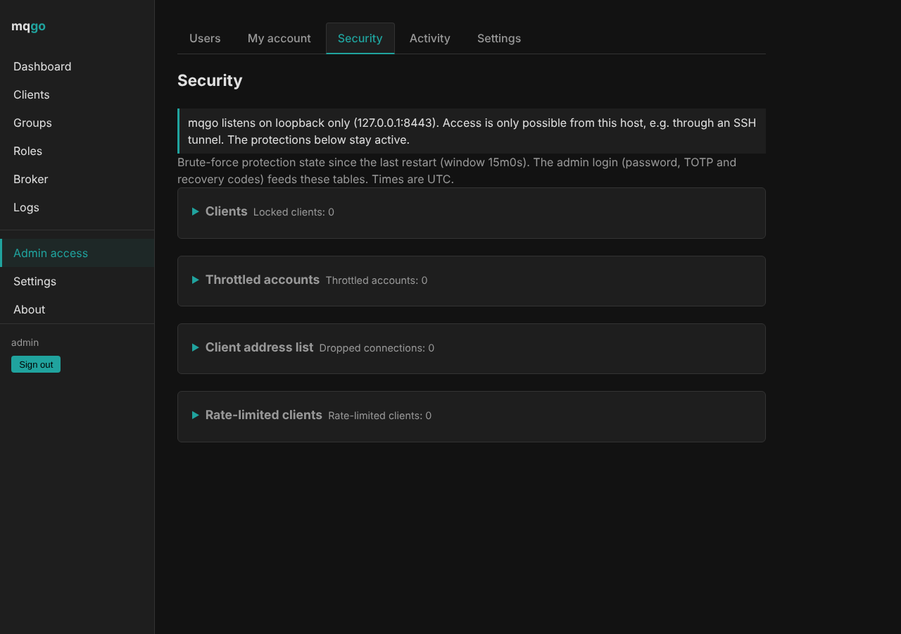

# mqgo

mqgo is a web admin UI for the dynamic security plugin of the Mosquitto
MQTT broker, in a single Go binary. It manages clients, groups, roles and
ACLs live on the broker.


## Focus

- **One Binary:** pure Go with embedded SQLite, no runtime dependencies,
  no `mosquitto_ctrl` needed.
- **The broker stays the source of truth:** mqgo talks to the plugin's
  control API (`$CONTROL/dynamic-security/v1`) and keeps no copy of the
  configuration. Changes made with `mosquitto_ctrl` show up at once.
- **Build around the entities:** clients, groups and roles link to each
  other; every assignment can be made where you see it, and each client
  page shows the client's effective rights in the order the broker checks
  them.
- **Secure by default:** HTTPS (self-signed or Let's Encrypt), optional
  TOTP per admin, CSRF protection, strict CSP, protection of the admin
  login against password guessing, bounded admin sessions, an optional list
  of IP addresses allowed to reach the admin UI; plain HTTP only when
  configured explicitly, behind a TLS-terminating tunnel.
- **From zero to dynsec:** `sudo mqgo install` sets up the dynamic
  security plugin from any starting point: no Mosquitto, no
  authentication, `password_file`/`acl_file`, `per_listener_settings`, or
  the plugin already active. Existing clients keep what they could do, or
  every difference is listed before anything changes. It takes a full
  snapshot, rolls back on errors and can restore the original state.

## Screenshots












More screenshots of every page are in [Administration](docs/administration.md).

## Features

**Broker configuration**
- Clients: create with password and optional client ID, delete, change
  password and client ID, enable/disable, disconnect, name and description
- Groups: members and roles with priorities, the anonymous group
- Roles: ACLs of all six types with allow/deny and priority, editable;
  copy a role with all its ACLs; default ACL access
- Comments on ACLs, kept by mqgo (the plugin cannot store them)
- Client list with paging, search, the connection status of each client
  (from the broker's log) and export as CSV or JSON
- Errors are shown as the broker reports them
- Listeners of Mosquitto with their TLS certificates, read from a TLS
  handshake with the listener: type, validity, fingerprints including
  Tasmota's `MqttFingerprint`, expiry warnings
- Refused MQTT connections from the Mosquitto log, per IP address and
  client ID

**Operation**
- Dashboard with connected clients and message rates from `$SYS`
- Logs: the Mosquitto log and mqgo's log with audit records of every
  change, paginated and filterable
- Message log: the messages on the broker, live, with MQTT topic filters;
  off by default, in memory only
- `mqgo install`: system service running as an unprivileged user, and the
  dynamic security plugin set up in the same run, with import of password
  and ACL files, impact analysis, snapshot and rollback;
  `mqgo mosquitto-restore` undoes it
- First-run setup wizard with a one-time token, several admin accounts

**Security**
- Admin UI over HTTPS with a self-signed certificate or one from Let's
  Encrypt (ACME, renewed automatically); TLS off only explicitly, for
  running behind a tunnel
- Optional TOTP two-factor authentication per admin, recovery codes
- CSRF tokens, Origin check, strict Content Security Policy
- Admin login protected against password guessing: an IP address (IPv6:
  its /64 prefix) is locked out after repeated failed logins, and an admin
  account is throttled after repeated failed logins from any address
- Optional list of IP addresses allowed to reach the admin UI
- All settings that concern access to the admin UI itself (admin accounts,
  2FA, login protection, sessions, listener and TLS) under one navigation
  entry, Admin access

## Download

Release archives are on the release page:
https://github.com/joernfeuerabend/mqgo-releases/releases/latest

| Asset | Platform |
|---|---|
| `mqgo_<version>_linux_amd64.tar.gz` | Linux, x86-64 |
| `mqgo_<version>_linux_arm64.tar.gz` | Linux, ARM64 |
| `SHA256SUMS` | SHA-256 checksums of the archives |

Each archive contains the binary `mqgo`, `LICENSE`, `COMMERCIAL-LICENSE.md`
and `THIRD_PARTY_LICENSES`. Check the download and unpack it:

```sh
sha256sum -c --ignore-missing SHA256SUMS
tar -xzf mqgo_<version>_linux_<arch>.tar.gz
```

## Quick start

On a Linux host with systemd – with or without Mosquitto:

```sh
tar -xzf mqgo_<version>_linux_<arch>.tar.gz && sudo ./mqgo install --dry-run   # show everything it would do, change nothing
sudo ./mqgo install
```

One command, whatever the starting point: it installs the service,
installs Mosquitto if it is missing (Debian/Ubuntu), sets up the dynamic
security plugin – or adds an account for mqgo to an active one – and
connects mqgo. Every change to Mosquitto is in the plan first, with the
impact on existing clients; it is backed up and rolled back on errors. At
the end it prints a setup URL with a one-time token and the fingerprint of
the admin certificate. Open the URL (continue only if the browser shows
that fingerprint) and create the first admin account.

```sh
sudo mqgo mosquitto-restore            # undo the Mosquitto setup later
sudo ./mqgo install -no-mosquitto      # broker on another host
```

Setup token expired? `sudo mqgo setup-info` prints a new one.

## Documentation

- [Installation](docs/installation.md): install, setup wizard, connecting the broker, domain and certificate
- [Mosquitto setup](docs/mosquitto-setup.md): what `install` changes in Mosquitto, impact on existing clients, backup and restore, import of password and ACL files, anonymous clients
- [Running behind a tunnel](docs/tunnel.md): TLS off, `public_url`, login lockout when every request comes from the tunnel's address
- [Administration](docs/administration.md): clients, groups, roles, priorities, ACL comments, admin users and 2FA, logs
- [Configuration](docs/configuration.md): config file and all keys

## License

Copyright (C) 2026 Jörn Feuerabend

mqgo is licensed under the PolyForm Noncommercial License 1.0.0
(PolyForm-Noncommercial-1.0.0), which permits noncommercial use only. See
[LICENSE](LICENSE).

Any commercial use requires a separate commercial license. See
[COMMERCIAL-LICENSE.md](COMMERCIAL-LICENSE.md).

Third-party components and their licenses are listed in
[THIRD_PARTY_LICENSES](THIRD_PARTY_LICENSES).
