# Administration

## Navigation

The main navigation follows the broker: **Dashboard**, **Clients**,
**Groups**, **Roles**, **Broker** (connection, dynsec admin account,
setup, listeners and certificates, rejected connections), **Logs**, then
**Admin access**, **Settings**, **Update** and **About**.

**Admin access** holds everything that concerns only the admin UI's own
access, not the broker. Its pages have their own tabs: **Users**, **My
account**, **Security**, **Activity** and **Settings** (the sections
network, TLS & domain, limits, brute-force protection and admin sessions,
at `/admin/access/settings`). The main **Settings** page keeps the broker,
storage, logging, health and updates sections. Every URL of earlier versions still
works (`/admin/security`, `/admin/status`, `/admin/users`,
`/admin/account`, `/admin/settings`, `/admin/logs…`).

**Folded view.** On Admin access → Settings the group *HTTP server*
(timeouts, HTTP/2 streams) and the section *Connections & limits* are
folded (`
`). While the admin UI listens on loopback only
(`webgui_listen_address` 127.0.0.0/8, `::1` or `localhost`, e.g. behind an
SSH tunnel, see [Running behind a tunnel](tunnel.md)), Security and
Activity show the note "mqgo listens on loopback only (…)" and every card
folded with a summary line ("Locked clients: 0", "Throttled accounts: 0",
"Dropped connections: 0", …), and the TLS and brute-force sections are
folded as well. Port, listen address and allowed addresses stay visible.
A folded part opens by itself when it has something to show: a locked
address, a throttled account, dropped connections, a rate-limited address,
failed logins in the last 24 h (Activity), a field error, a value other
than the default or a saved value not yet in effect. Warnings stay
visible above the folded cards. Folding changes only the display: every
protection works the same, and every card can be opened. The automatic
refresh of the Activity cards does not close an opened card. A change of
`webgui_listen_address` by Apply takes effect at the next page view.

## Clients, groups and roles

mqgo reads everything live from the broker's dynamic security plugin and
sends every change there; it keeps no copy of the configuration. Each
page is built around one kind of entity:

- **Clients** – the MQTT accounts: username, password, optional client ID
  (then the client may connect only with that ID), name and description,
  enabled/disabled. The client page shows its roles and groups (with
  priority) and its **effective rights**: every ACL that applies to it, in
  the order the broker checks them, with links to the role and group they
  come from, and the default access below.

  **Disconnect client** (left of Disable client, shown only for an enabled
  client) closes every open connection of the username at the broker. The
  client stays enabled, nothing of its configuration changes, and it can
  log in again at once. mqgo sends the plugin's `modifyClient` command with
  the username only: the plugin then changes nothing and disconnects all
  connections of that username, without their will messages (Mosquitto
  2.0.x, `plugins/dynamic-security/clients.c`). Mosquitto logs
  `Client <client id> been disconnected by administrative action.` for each
  connection, which the connection history shows as "disconnected by the
  broker"; it is not a rejected connection. MQTT 5 clients receive a
  DISCONNECT with reason code 0x98 (administrative action). The confirmation
  says when the Mosquitto log shows the client as not connected. The audit
  log records `action=disconnectClient`.

  **mqgo's own account.** The client whose username is stored as the
  broker account on the Broker page is the one mqgo connects with. Its
  page says so ("mqgo connects to the broker with this account. Actions
  that would disconnect or lock out mqgo are not available here."), and
  the client list marks it with the badge **mqgo**. For this client:
  - Disconnect, Disable and Delete are not offered, and the password and
    client ID forms are replaced by notes. Change its password on the
    broker host, then enter it on the Broker page. mqgo logs in with a new
    client ID (`mqgo-…`) on every connection, so a fixed client ID would
    make the broker refuse mqgo. A POST to these actions is refused with
    a message, nothing is sent to the broker, and the audit log records
    `result=refused`.
  - Removing a role or group from it, removing a role from one of its
    groups, deleting one of its groups or roles, and adding, changing or
    removing an ACL of one of its roles (directly or through a group) is
    allowed, but asks for confirmation and warns that mqgo can no longer
    manage the broker if that removes its access to
    `$CONTROL/dynamic-security/#`.
  - Every change that makes the broker disconnect this account (its name
    and description, its roles and groups, and changes of its groups and
    roles) also closes mqgo's own connection before the broker's answer
    arrives. mqgo then waits up to 10 seconds for its reconnect, checks
    the change at the broker and reports, for example, "Saved. mqgo was
    briefly disconnected by the broker and has reconnected." If the change
    is not there, or mqgo has lost its access to the control API, the page
    says so.
  - Without stored broker credentials nothing is restricted.
- **Groups** – sets of clients that share roles. The group page lists the
  members and the roles. The Groups page also sets the **anonymous group**,
  whose roles apply to clients connecting without a username. The client
  picker of the group page shows each client as "username — name"; it
  offers the first 50 clients that are not members, and its filter box
  searches username and name on the server.
- **Roles** – carry the ACLs. The role page lists the ACLs in check order,
  and the clients and groups that have the role. A new role can copy all
  ACLs (with their priority, allow/deny and comments) of an existing one.
  The Roles page also sets the **default ACL access** (publish, receive,
  subscribe, unsubscribe), which applies when no ACL matches.

Every reference is a link, and every assignment can be made and removed on
both pages it connects (e.g. a role is assigned to a client on the client
page or on the role page). Entities are chosen from a list with a filter.
After each action the page shows the outcome; errors are the broker's own
message, unchanged. Deleting and removing ask for confirmation.

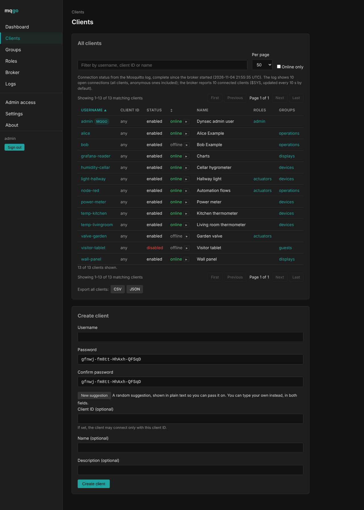
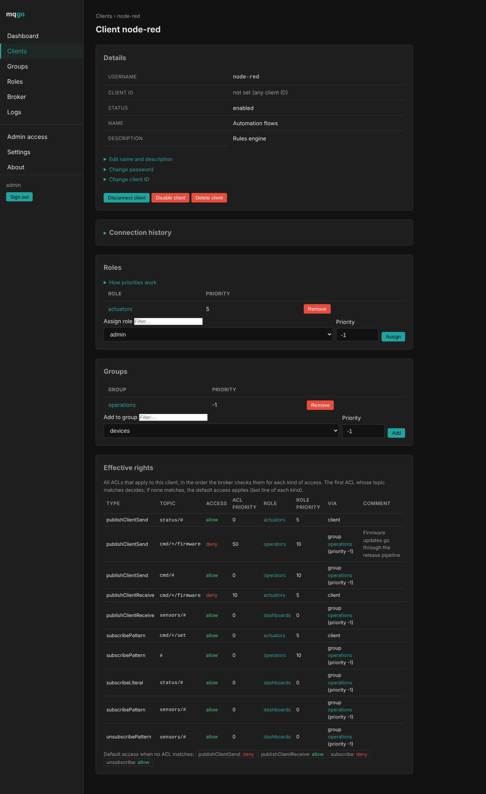
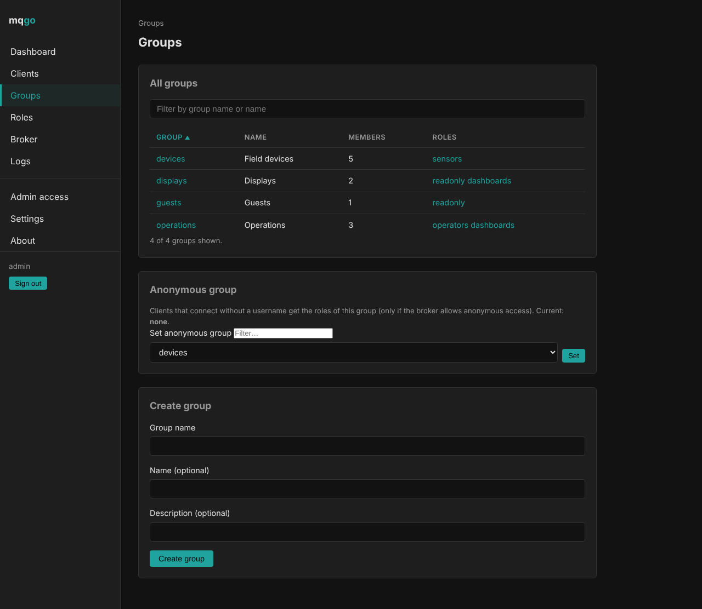
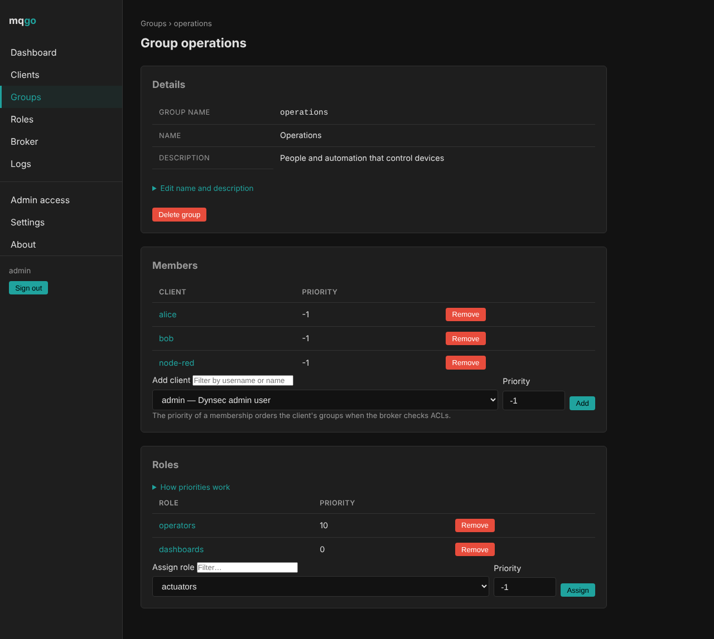
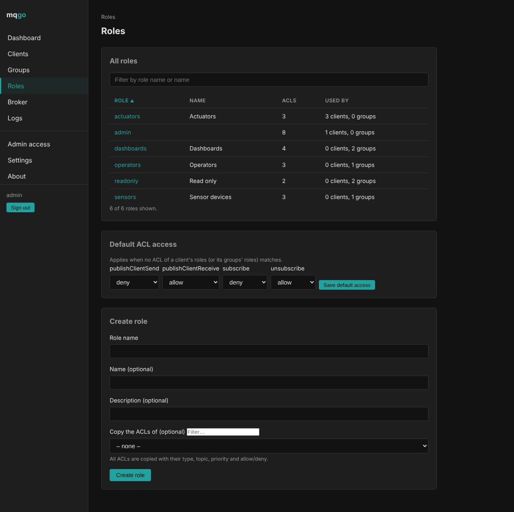

### Client list

The Clients page shows one page of clients (25, 50 or 100), with page
navigation above and below the list. Without a filter, mqgo asks the
plugin for exactly that page (`listClients` with `count` and `offset`).
The filter (username, client ID or name) and **Online only** run on the
server: mqgo reads the clients in chunks of 500 and sends only the page
to the browser. Every `listClients` is one line in the broker's log (the
plugin logs its commands at level information).

Every column heading of the Clients, Groups and Roles lists sorts the
list: the first click ascending, the next one descending (▲/▼). Columns
with several values (roles, groups, members, used by) sort by their
number; equal entries stay in the order of the name. The filter and the
page navigation keep the order. Sorted by username, the client list is
read page by page from the plugin as before; any other column reads all
clients on the server (as the filter does) and sends one page.

The column **Connection** shows whether a client is connected:
"online", "online (2)" for a username with two connections (different
client IDs), "offline" or "unknown". The plugin does not know this, and
no Mosquitto version lists connected clients over its control API, so mqgo
follows the broker's log (`mosquitto_log`): Mosquitto writes a line for
every connect and disconnect (with `connection_messages true`, the
default). At start mqgo reads the last 8 MiB of the log:

- if they contain the broker's start, every connection since then is
  known, and a client without one is "offline";
- otherwise a client without a connect or disconnect in that part is
  "unknown", never "offline".

Both timestamp forms of the log are read: Mosquitto's default (seconds
since 1970) and one set with `log_timestamp_format` (e.g.
`%Y-%m-%dT%H:%M:%S`). mqgo checks that its own connection is in the log. If it is not – log on
another host, another file, `connection_messages false`, the file not
readable – every client is "unknown", and the page says why. Above the
list the page names the source and since when it is complete, and
compares the open connections in the log with the broker's own count
(`$SYS/broker/clients/connected`). The index lives in memory only:
username → number of connections and time of the last change; entries of
deleted clients are removed (at once for deletions in mqgo, every 15
minutes for others), and at most 20 000 disconnected usernames are kept.

The Dashboard tile **Connected clients** comes from
`$SYS/broker/clients/connected`. Mosquitto 2.0.0 to 2.0.15 publish that
value with a message expiry of 60 s and again only when the number
changes; after a restart of mqgo it may therefore not arrive until a
client connects or disconnects. Meanwhile the tile shows the number of
open connections from the Mosquitto log ("now, from the Mosquitto log"),
when that source works; its tooltip gives the reason.

### Connection history

The arrow next to a username in the client list, and the card
**Connection history** on the client page, show from the broker's log
when, from which IP address and with which client ID the client
connected:

- the last login with its address and client ID, the number of logins,
  addresses and client IDs, and all addresses with their last login;
- the newest 10 connections (up to 50 under "Older connections") with
  connect and disconnect time, the reason of the disconnect and the
  duration;
- **parallel use:** two connections of the username that were open at
  the same time, with how long. A reconnect while the old connection is
  dead but not yet timed out (Mosquitto notices it after 1.5 × the
  keepalive) is shown as a *brief overlap*, not as parallel use.

At start mqgo reads the rotated copies of the log (`mosquitto.log.1`,
`.2.gz`, …, or dated names with logrotate's `dateext`) and the current
file, then follows new lines. Rotated files mqgo may not read are named
below the history. Only a summary is kept in memory (50 connections, 100
addresses and 100 client IDs per username, 50 000 usernames).

### Export

Below the list: **Export all clients** as CSV or JSON, and with a filter
set also **Only the matching clients**. The export contains username,
name, description, client ID, disabled, groups and roles with priority,
the ACL comments mqgo keeps for the client's roles (its own and those of
its groups; mqgo has no other comments), the connection status with its
time and the time of the export. No passwords or hashes: the plugin never
returns them. The file is written while the clients are read (chunks of
500), so it does not grow mqgo's memory.

CSV: UTF-8 with byte order mark; several values in one cell are separated
by "; " (a ";" or "\" in a name is escaped with "\"); a cell starting with
`=`, `+`, `-`, `@`, tab or carriage return gets a leading `'`, so that a
spreadsheet does not run it as a formula. JSON: one object with
`exported_at`, `scope`, the status source, `clients` and `complete`. If the
broker stops answering in the middle, the file ends with an error line
(CSV) or `"complete": false` and the error (JSON).

### ACLs and priorities

ACL types: `publishClientSend`, `publishClientReceive`, `subscribeLiteral`,
`subscribePattern`, `unsubscribeLiteral`, `unsubscribePattern`; each
allows or denies one topic (filter).

- Within a role, ACLs are checked by priority, highest first; the first
  ACL whose topic matches decides. New ACLs get priority 5.
- A client's own roles are checked first (highest role priority first),
  then the roles of its groups (highest group priority first). Role
  assignments and group memberships get priority -1 (the broker's
  default).
- If nothing matches, the default ACL access decides.

Editing an ACL changes its priority and allow/deny (the broker has no
command for that: mqgo removes and re-adds it, and puts the old one back if
the second step fails).

### ACL comments

The plugin stores only type, topic, priority and allow/deny of an ACL.
Comments on ACLs are therefore kept in mqgo's database. They move with an
ACL edit, are copied with a role, and are deleted with their ACL or role.
If an ACL is removed outside mqgo (e.g. with `mosquitto_ctrl`), its comment
is listed as *orphaned* on the role page and can be deleted there.

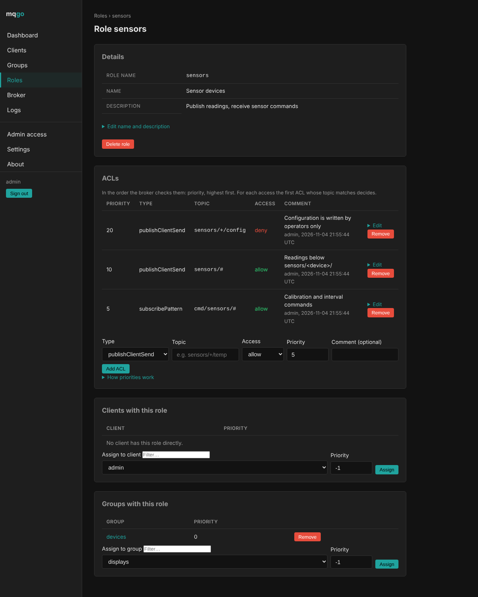

## Broker connection

**Settings → Broker** holds the address: `mqtt_host`, `mqtt_port`, and for
TLS `mqtt_tls`, `mqtt_ca_file`, `mqtt_server_name`. The **Broker** page
holds the dynsec admin account. Its password is stored in mqgo's database
(directory 0700, file 0600, owned by the service user), never logged and
never shown again – an empty password field keeps it, a new value replaces
it. The account needs the rights of the admin role `dynsec init` creates
(control API and `$SYS`); `mqgo install` creates such an account.

States: *connected*; *not connected* (retried every 3 s); *authentication
failed*; *dynsec not active* (connected, but the plugin does not answer –
run `sudo mqgo install`).

After the Mosquitto setup by `install` the Broker page shows when it ran, its backup, the
restrictions that were accepted and how to undo it
(`sudo mqgo mosquitto-restore`); after a restore, which backup was
restored and how to undo that. Setup and restore need root and run only on
the command line – the admin UI has no button for them. Backups:
`sudo mqgo mosquitto-backups`, in `/var/backups/mqgo`, never
deleted by mqgo (see [Mosquitto setup](mosquitto-setup.md#backup-snapshot)).

### Listeners and certificates

The Broker page lists the listeners of the Mosquitto configuration
(setting `mosquitto_conf`, default `auto`: the path the last `mqgo
install` recorded, else `/etc/mosquitto/mosquitto.conf`; `include_dir` is
followed): port, bind address, protocol (mqtt or websockets), TLS (or
PSK), whether a client certificate is required, and the paths of
`certfile`, `cafile` and `capath` as configured. mqgo reads the
configuration as the service user and changes no permission; a file it
cannot read is named with the cause.

mqgo never reads a certificate or key file; it takes each certificate
from a TLS handshake with the listener:

- The listener mqgo's broker connection runs over (`mqtt_tls`,
  `mqtt_port`): from that connection, without a further one.
- Other TLS listeners with `protocol mqtt`: mqgo connects (to the bind
  address, to loopback for a wildcard; with `mqtt_server_name` as SNI if
  the listener answers only to that), logs in with its dynsec admin
  account and a client ID `mqgo-…`, and disconnects at once, without
  subscribing or publishing. If the listener refuses the account (e.g.
  `per_listener_settings true` with its own authentication), the
  certificate is shown all the same with the note "mqgo's admin account
  was refused on this listener". These logins count like mqgo's broker
  connection: never as rejected connections. While no dynsec admin
  account is stored, mqgo does not connect to these listeners and the
  card says so. As soon as the broker connection is up with an account
  (stored on the Broker page, or by `mqgo install`), mqgo checks once
  more; ordinary reconnects do not check.
- Listeners with `require_certificate true` or `protocol websockets`: a
  TLS handshake only, closed right after it. A `require_certificate`
  listener refuses the handshake after sending its certificate; the
  certificate is shown all the same. These checks appear under Rejected
  connections as connections without CONNECT, and the card says so.

Shown per
certificate: subject, subject alternative names, issuer, type
(self-signed, signed by a private CA with the CA if the broker sends it,
publicly trusted), validity and days left, key, signature algorithm,
serial number, the SHA-256 and SHA-1 fingerprints and the Tasmota
`MqttFingerprint` (format of 8.4.0 and later, and the older format of
6.6.0 to 8.3.x), each with a **Copy** button, and whether
`mqtt_server_name` (else `mqtt_host`) is among the certificate's names.
For a self-signed or private-CA certificate a note reminds that devices
that pin it (Tasmota) need the new fingerprint before it is replaced.

From 30 days before expiry the listener shows a warning, an expired or
not yet valid certificate an error, both also as a banner on the Dashboard
("Certificate of listener 8883 expires in 12 days"), and mqgo logs one
line when a certificate enters either state. The check runs when mqgo
starts, after a restart of the broker (detected from
`$SYS/broker/uptime` falling), once when the broker connection comes up
after a check that lacked the account, and with **Check now**; the result is kept
in memory. Opening the page does not check; the expiry state is computed
from the stored validity whenever a page is shown, and an hourly timer
evaluates the stored data for the log lines without opening a
connection.

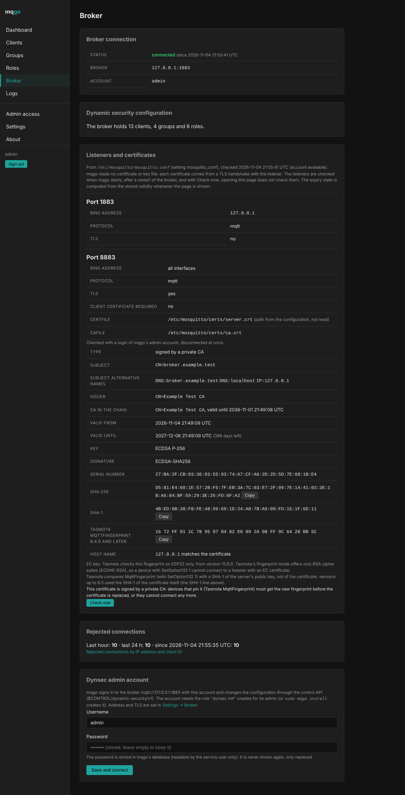

### Rejected connections

**Broker → Rejected connections** (`/admin/broker/rejected`) shows the
connections the broker refused, from the Mosquitto log that mqgo already
follows (`mosquitto_log`, rotated copies `.1`, `.2.gz`, … included): the
number in the last hour, the last 24 h and since the start of the log
read; a table per IP address (count, first and last time, reasons, client
IDs); a table per client ID (the username of an earlier successful login
with it, linked to the client, count, last address, reasons); and the
newest 100 refusals with time, address, listener, client ID and reason,
filtered by address, client ID or reason. The Broker page has a summary,
the Dashboard a tile "Rejected connections (24 h)", and a client's
connection history lists refused attempts with its client IDs.

Only what the log says is shown. Mosquitto 2.0 logs no username for a
refused connection, and the address only in the line that accepts the
connection: an attempt gets the address of the one accepted connection
that has not completed a CONNECT yet; with several at the same time the
address is "–". A wrong password, an unknown or disabled client and a
client ID the client may not use all appear as *not authorised* (Mosquitto
2.0.11 logs no client ID for them). Other reasons: TLS handshake failed
(with the OpenSSL text), closed without CONNECT, no CONNECT before the
timeout, protocol error, invalid protocol version. When the Mosquitto
configuration sets `connection_messages false` or a `log_type` without
`notice`, the page says so and shows no numbers; without `error` or
`information` it names the reasons that are missing. mqgo does not change
the Mosquitto configuration.

mqgo blocks nothing; blocking an address (for example fail2ban on the
Mosquitto log) is outside mqgo. Kept in memory: 10 000 refusals (newest),
10 000 addresses and 10 000 client IDs aggregated.

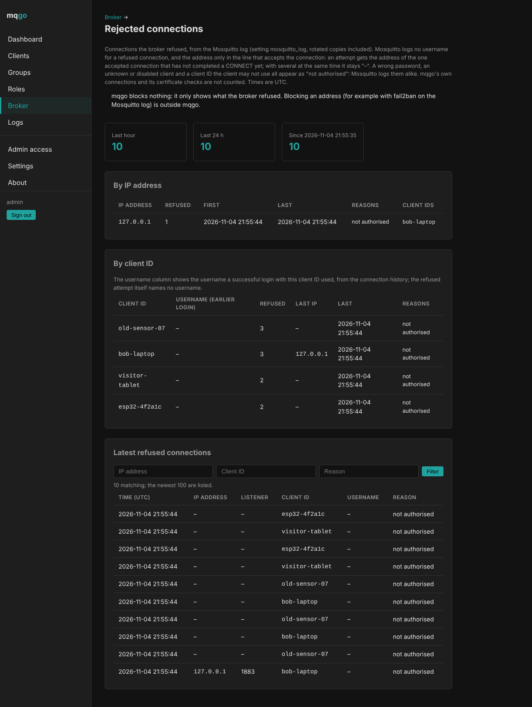

## Dashboard

The broker status and, from the broker's `$SYS` topics, connected clients
(mqgo's own connection included), messages received and sent per minute
(1, 5 and 15-minute averages), broker version and uptime. Mosquitto
publishes them every `sys_interval` seconds (default 10). Below them the
tile *Rejected connections (24 h)*, and at the top a banner for each
listener certificate that expires within 30 days or is not valid.

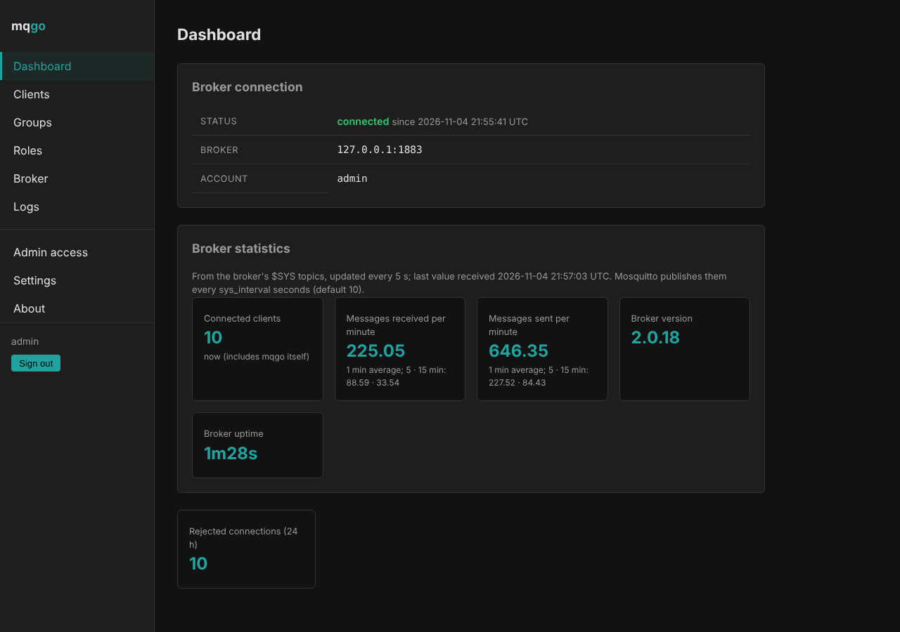

## Admin access

### Users

**Admin access → Users** lists the accounts of the admin UI. All are admins. Any
admin creates and deletes accounts and sets passwords; one's own account
and the last admin cannot be deleted. A password reset ends that user's
sessions. These accounts sign in to the admin UI only: mqgo has no other
login (no HTTP Basic Auth, no API token), and they are not MQTT accounts.

**Adding users.** **Users → Add user** asks for username and
password. The password field is prefilled with a random suggestion in
plain text, so it can be copied and passed on. **New suggestion** replaces
it with another one. A typed password works as well, at least 8
characters. A suggestion has 20 random characters in four groups of five
joined by dashes, e.g. `Kx7mR-pW4ta-9bQhE-u3NcV`. The dashes are part of
the password. The characters are letters and digits without `0 O o 1 l I`
(easy to confuse) and `y Y z Z` (swapped between German and US keyboard
layouts), 52 in all, which gives about 114 bits. The server generates them
with a cryptographic random source and never logs them.

**Setting a new password.** *Set new password* in a user's row works the
same way: the field holds a fresh suggestion, **New suggestion** replaces
it, and any password of at least 8 characters is accepted. The setup
wizard has the same minimum length.

**MQTT clients.** Create client and Change password on the Clients pages
work the same way: the password and the confirmation field hold the same
fresh suggestion in plain text, and **New suggestion** replaces both. A
typed password must be entered in both fields; the plugin sets no minimum
length for MQTT passwords, and neither does mqgo.

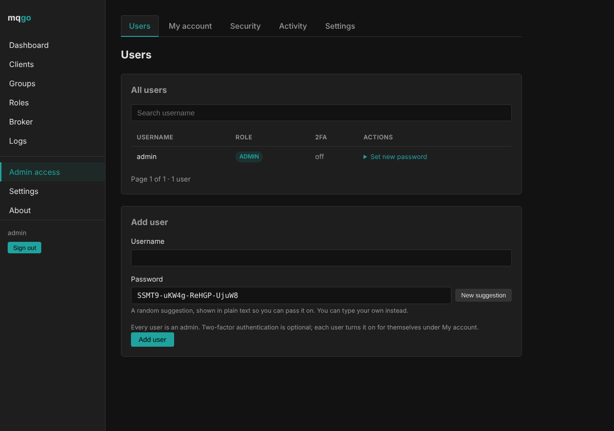

### My account: two-factor authentication

Two-factor authentication (TOTP) is optional per user. On **Admin access → My account**
each user turns it on (scan the QR code, confirm a code, store the 10
recovery codes, shown once) and off again (with a valid code or recovery
code). With 2FA, the password alone leads only to the code page; each code
works once, each recovery code once. The Users page shows who has
2FA; an admin can reset it for other users, who then sign in with their
password only.

### Session lifetime

A full admin session ends at whichever limit is reached first:
`admin_session_max_age` (default 86400 s) after sign-in, however active
the admin is, or `admin_session_idle_timeout` (default 3600 s) without a
request that counts as activity. The automatic refreshes of an open page
(Dashboard, Activity, Logs including the Mosquitto log and the Message
log, Broker status, certificate request progress) do not count, so a page
left open does not keep its session alive. When a session has ended, the
next page shows the login. Both limits are set under **Admin access → Settings →
Admin sessions**; Apply changes them for sessions that are already open. Values
above the NIST SP 800-63B-4 recommendation for AAL2 (24 hours, 1 hour) are
accepted with a warning. A session waiting for the second factor ends
after 5 minutes, whatever the limits.

Lost authenticator and recovery codes: `sudo mqgo reset-totp <user>` turns
2FA off from the shell and ends that user's running sessions.

### Security

The page shows the state of the protection of the admin login against
password guessing. It concerns only logins to the admin UI, not MQTT
clients. Addresses are IPv4 addresses or IPv6 /64 prefixes; the page
calls them clients.

- **Locked clients:** addresses locked out after too many failed logins,
  with Unlock.
- **Throttled accounts:** admin usernames with too many failed logins from
  any address; only one password check per interval runs for them, never a
  hard lock. With Clear.
- **Rate-limited clients:** addresses held back by the connection limit per
  address.
 All limits are set under Admin access → Settings, sections
Brute-force protection and Connections & limits.

Details of the account throttle:

- Every check that lets a caller guess like a login runs through it: the
  password, the second factor (TOTP or recovery code), turning one's own
  2FA off and resetting one's own TOTP.
- A request the throttle refuses (429) counts as a failed login of its
  address, so an address that polls for the next free check locks itself
  out. With `bruteforce_client_lockout = false` nothing is counted per
  address.
- A username that cannot exist (not 3–32 lowercase letters, digits, `-` or
  `_`) is answered like a wrong password without a password check. It
  counts toward the address lockout only and never gets an entry in the
  account table, so attackers cannot fill it with invented names.
- **Known addresses:** an address that signed in to an account completely (password, and the second factor if the account has
  2FA; also the setup wizard and a confirmed 2FA enrolment) is not
  throttled for that account for 30 days. An attacker who keeps the
  throttle engaged therefore does not slow the admin down on their usual
  devices. The table is bounded by `bruteforce_max_entries` (the oldest
  entry goes first) and starts empty at every service start. **This
  exemption only applies while `bruteforce_client_lockout = true`.** With
  the lockout off, behind a tunnel every browser has the tunnel's address,
  and one login would exempt everyone; then every address is throttled
  alike, nothing is learnt, and turning the lockout off forgets the known
  addresses. The Security page shows their number (*known clients*), or
  says that the exemption does not apply.

The table **Client address list** shows the running
`webgui_allowed_clients`, the connections dropped since the last restart
because their address is not in it, the time of the last drop and the
latest distinct addresses dropped. With `tls_mode = "acme"`, handshakes
that offer only `acme-tls/1` are let through to the challenge certificate
and are not counted, HTTP requests on such connections are. When the list
is set and `public_url` or `allow_insecure_http` points to a tunnel, the
page warns that the list cannot tell the browsers behind the tunnel apart. See
[Client address list](configuration.md#client-address-list).

`bruteforce_client_lockout = false` turns the lockout per address off (e.g.
behind a tunnel, see [Running behind a tunnel](tunnel.md)); the page then
shows a warning, as it does for `tls_mode = "off"`.

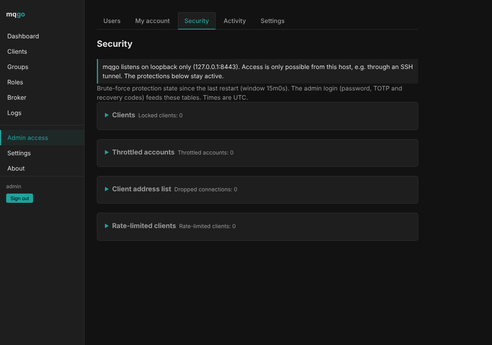

### Activity

**Admin access → Activity** (`/admin/status`): active admin sessions,
the open connections of the admin listener, and traffic and login
statistics of the last 24 hours. The size of the data directory and of
the database are under **Settings → Storage**.

## Logs

The first two tabs show log records newest first, 50 records per page
(25 or 100 selectable), with page navigation above and below the list and
an optional refresh every 2 s (on page 1 only; on later pages it is off
and the page says so). Filters stay set while paging; changing a filter
starts on page 1.

- **Mosquitto log** (`/admin/logs`, the first tab): the broker's log file
  (`mosquitto_log`, default `/var/log/mosquitto/mosquitto.log`) with a text
  filter. mqgo reads the last 8 MiB of the file; older lines are in the
  file and its rotated copies. Mosquitto writes it with
  `log_dest file <path>`. The time column is filled for the default
  timestamp and for common `log_timestamp_format` layouts (e.g.
  `%Y-%m-%dT%H:%M:%S`, read as local time and shown in UTC). If mqgo may not read it, the tab names the steps:
  `sudo mqgo install` does them (group, mode 0640, logrotate,
  restart of mqgo), or by hand.
- **mqgo log** (`/admin/logs/mqgo`): the newest records of mqgo's own log
  (`log_buffer_entries`), filterable by level and text. **Audit entries
  only** shows the records of every change to the broker configuration and
  the ACL comments (message `audit`: `action`, `target`, `by`, details,
  `result`). Passwords never appear in the log.

- **Message log** (`/admin/logs/messages`): the messages published on the
  broker, live; off by default. **Switch on** makes mqgo subscribe to `#`
  (all topics except those starting with `$`); it unsubscribes when the
  last viewer switches it off, leaves the page, closes the tab or signs
  out (a tab that stops polling is dropped after 15 s). Each message shows
  time, topic, QoS (as published: mqgo subscribes with QoS 2), retain flag
  (as published; the retained messages sent right after switching on have
  it as well) and the payload – text, or for binary payloads a hex preview
  and Base64. **Topic filters** with `+` and `#` (several: a message is
  shown if it matches any), with suggestions from the topics seen;
  **Pause**/**Resume** and **Clear** act on this tab only. Memory: the
  newest `message_log_entries` messages (default 1000, at most 10 000;
  32 MiB in all), payloads cut to 4 KiB, at most 5000 seen topics; freed
  when the log is switched off. Nothing is written to disk. At most 200
  messages per second reach the page; more (for example the retained
  messages after switching on) are counted as not shown.
  If the broker refuses the subscription (the account of mqgo may not
  subscribe to `#`), the tab says so and names the ACLs the account would
  need (`subscribePattern #` and `publishClientReceive #`, allow); mqgo
  never changes its own rights. The role `mqgo install` creates for mqgo
  has them, as has the admin role of `mosquitto_ctrl dynsec init`.

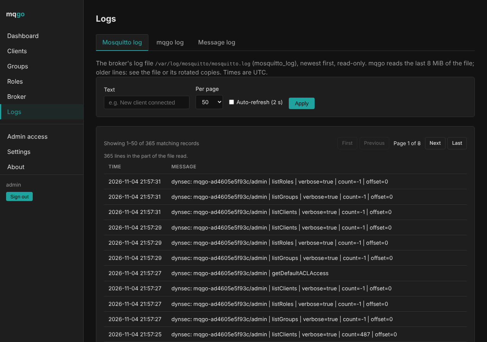
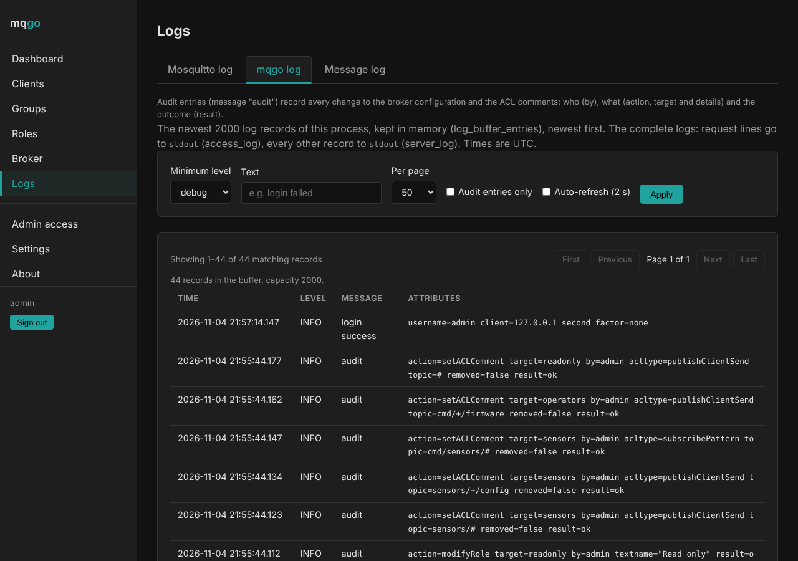
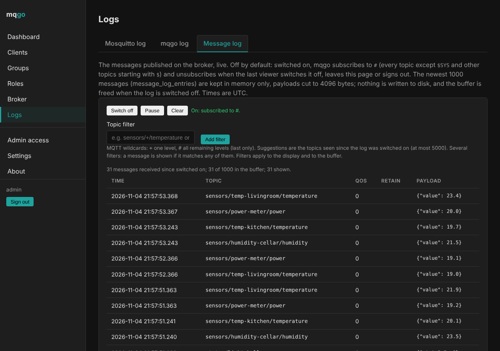

## About

The About page shows the license notice and the version information the
binary has: the version (set at build time; a release built by the GitHub
workflow shows its tag, linked to its page in
[mqgo-releases](https://github.com/joernfeuerabend/mqgo-releases/releases)), the commit and its time with a note if the build
had local changes (recorded by Go when it builds in a git checkout), the
Go version and the platform. Fields the binary does not have are left out.

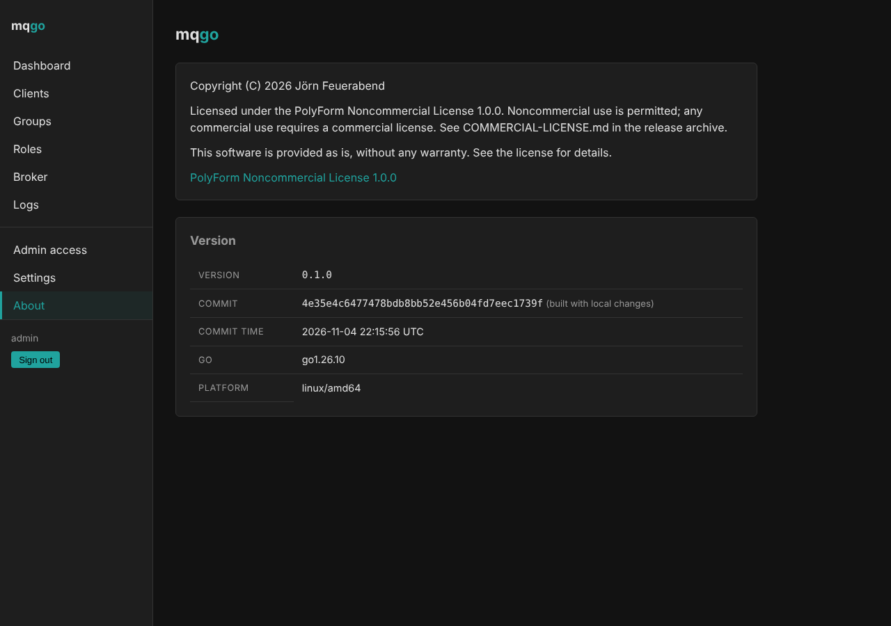

## Update

The Update page shows the installed version and checks for a newer one.
mqgo contacts GitHub only when an admin clicks **Check for updates**: it
reads the releases of the public repository
[joernfeuerabend/mqgo-releases](https://github.com/joernfeuerabend/mqgo-releases/releases)
without authentication. A release is offered only if

- its tag is a release version (`vX.Y.Z`) or a pre-release version
  (`vX.Y.Z-alpha.N`, `-beta.N`, `-rc.N`), newer than the installed version
  by SemVer 2.0.0 (never a downgrade; a build past a tag, such as
  `v1.2.3-4-gabcdef`, ranks with its tag),
- it has a `SHA256SUMS.minisig` asset, a minisign signature of
  `SHA256SUMS` that verifies against one of the release keys built into
  the binary (`cmd/mqgo/keys`: the main key, or the reserve key that takes
  over if the main key is lost or compromised), and
- the signed `SHA256SUMS` lists the tarball for this architecture, and the
  release has it.

A release is published first and signed afterwards: until it carries
`SHA256SUMS.minisig` it is public, but not offered. Pre-releases are
offered only while `update_prereleases` is on (**Settings → Updates**);
the page then shows a warning. Newer releases that are not offered are
listed with the reason.

**Install update** asks for confirmation, downloads the tarball,
`SHA256SUMS` and `SHA256SUMS.minisig` into `/var/lib/mqgo/update` and
places a request file there. The systemd path unit `mqgo-update.path`
then starts `mqgo-update.service`, which runs the installed, root-owned
binary as `mqgo apply-update` (no network, `NoNewPrivileges`). The helper
trusts nothing in the update directory, which belongs to the service
user: it reads only regular files of bounded size and does not follow
symlinks, checks the signature, the SHA-256 of the tarball and the
version again, and refuses anything not newer than itself. Only then it
keeps the current binary as `/usr/local/lib/mqgo/mqgo.previous`
(root-owned, outside the service's writable paths), installs the new one,
restarts the service and writes its report, which the Update page shows.
The restart logs every admin out; the page opens the login page once the
service answers again. `journalctl -u mqgo-update` shows the helper's log.

The helper units exist only if `install` prepared the installation for
updates via the web UI (see [Installation](installation.md#updates-via-the-web-ui));
otherwise the page says how to enable it.

## Log files

`access_log` (request lines) and `server_log` (everything else), by default
in `/var/log/mqgo`; reopened on SIGUSR1 (the installed logrotate
configuration does that). With `server_log` set, errors also go to stderr,
so the journal shows why a start failed.

Values a request can choose (paths, methods, `Origin`, `Referer`,
`Sec-Fetch-Site`, usernames before they are validated) are cut in log lines
to 256 bytes (usernames to 32), followed by `…[truncated, N bytes]` with
the original length. The Warn lines anyone can trigger without valid
credentials, `"login refused: throttled"` and `"admin request rejected:
cross-origin"`, are written at most once a minute per address and message;
the next line carries `suppressed=N`, the number left out in between. That
table is bounded by `bruteforce_max_entries`.

## Health checks

With `health_enabled = true` a plain HTTP listener (default
`127.0.0.1:8082`) answers `GET /livez` and `GET /readyz` (data directory
writable, database answers). `mqgo healthcheck` queries it.
