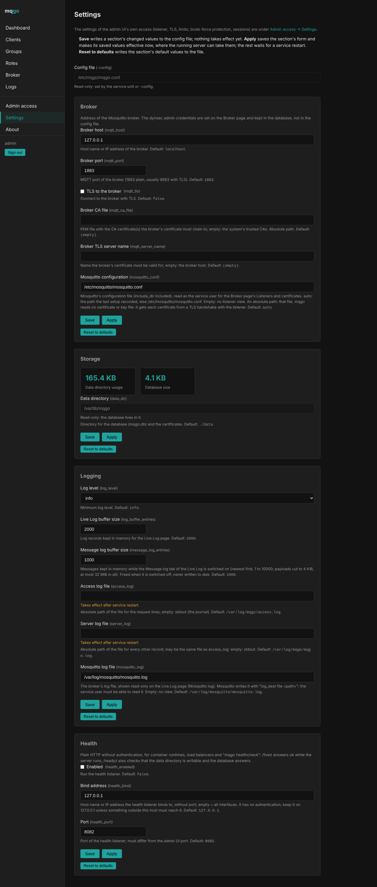

# Configuration

mqgo reads one file, `/etc/mqgo/mqgo.conf` (or the file given with
`-config`). It holds every setting as flat `key = value` lines (TOML). The
database (`<data_dir>/mqgo.db`) holds runtime data only: the admin users,
their 2FA secrets, the setup token, session epochs, the broker credentials
and the ACL comments. mqgo never keeps a copy of the broker's
configuration; the broker is the source of truth.

- **Precedence:** command-line flag > config file > default. Flags:
  `-config`, `-data-dir`, `-log-level`.
- **Missing file:** the service creates it, and its directory, from the
  built-in example (every key with its default and a description). The CLI
  commands (`setup-info`, `reset-totp`, `mosquitto-restore`, `mosquitto-backups`) never create it.
- **Unknown keys** are rejected at startup, so a misspelt key never falls
  back to its default silently.
- **Units:** durations in whole seconds, sizes in KB, rates in KB/s
  (1 KB = 1000 bytes).

## Settings page

The admin UI shows every key, grouped in sections, on two pages:
**Settings** (`/admin/settings`: Broker, Storage, Logging, Health) and
**Admin access → Settings** (`/admin/access/settings`: Network &
listeners, TLS & domain, Connections & limits, Brute-force protection,
Admin sessions, the sections that concern only the admin UI's own access).
Each shows every key of its sections with
its default and the value the running process uses. **Save** writes the
section's changed keys to the config file: only their lines are rewritten,
comments and your own edits stay. **Apply** saves and then makes the values
effective where the running process can take them – listener addresses
move without a restart, the broker connection reconnects. Keys marked
"takes effect after a restart" wait for `systemctl restart mqgo`.
**Reset to defaults** writes the section's defaults.

On Admin access → Settings the group *HTTP server* and the section
*Connections & limits* are folded; while the admin UI listens on loopback
only, *TLS & domain* and *Brute-force protection* are folded too. A
folded part opens when a field has an error, a value other than the
default or a saved value not yet in effect (see
[Administration](administration.md#navigation)).

With `tls_mode = "acme"`, Save and Apply in the TLS section run the
certificate request instead (see [Installation](installation.md#domain--certificate)).

The broker's address is a config key; the username and password of the
dynsec admin account are not, they are set on the **Broker** page and kept
in the database (see [Administration](administration.md#broker-connection)).



## Client address list

`webgui_allowed_clients` limits which IP addresses may connect to the
admin UI. It has no effect on MQTT clients. An empty list (the default)
allows every address. A non-empty
list is a comma separated list of IPv4 and IPv6 addresses and CIDR
prefixes:

```toml
webgui_allowed_clients = "192.0.2.10, 198.51.100.0/24, 2001:db8:1234::/48"
```

- **IPv6:** list prefixes rather than single addresses. Devices with
  privacy extensions change their address every few hours, so a single
  IPv6 address stops matching soon. The prefix your provider delegates to
  your network (often a /48 or /56) covers every device in it, a /64
  covers one network segment.
- **Format:** an entry with host bits set beyond its prefix length (such as
  `192.0.2.5/24`) is invalid, write `192.0.2.0/24`. Addresses with a zone
  (`fe80::1%eth0`) are invalid. IPv4-mapped IPv6 entries
  (`::ffff:192.0.2.10`) are taken as their IPv4 form, and so are the
  addresses a dual-stack socket reports, so an IPv4 entry matches
  either way.
- **Drop:** a connection from an address outside the list is reset (TCP
  RST, `SO_LINGER` 0) right after accept, before TLS and before HTTP. The
  browser gets no response at all. Such connections do not count for the
  [brute-force protection](administration.md#security) or the
  connection limit per address (`max_connections_per_ip`).
- **Loopback:** `127.0.0.1` and `::1` (all of `127.0.0.0/8`) are always
  allowed, whatever the list says. Access through an SSH tunnel therefore
  always works. On the Settings page, Save and Apply of
  `webgui_allowed_clients` are refused when the address of the browser
  making the change would not be allowed afterwards. Apply also checks a
  list edited by hand in the config file or saved from another address.
- **Behind a tunnel:** the list sees the address of the connection, not of
  the browser. A tunnel connector on this host connects from loopback, so
  the list has no effect on anything that comes through the tunnel; a
  connector on another host has one address for every browser behind it.
  With the
  list set and `public_url` or `allow_insecure_http` set, the Settings and
  Security pages say so. See [Running behind a tunnel](tunnel.md#client-address-list).
- **`tls_mode = "acme"`:** the certificate authority validates
  TLS-ALPN-01 on the admin listener from changing addresses that cannot be
  listed. With `tls_mode = "acme"` (and on the listener the certificate
  request opens on port 443) a connection from an address outside the list
  is therefore not dropped at accept but in the TLS handshake: a ClientHello that offers
  anything other than `acme-tls/1` alone is answered with a reset. A
  ClientHello that offers only `acme-tls/1` completes the handshake with
  the challenge certificate and `acme-tls/1` as the only possible protocol,
  and any HTTP request on such a connection is answered with a reset. No
  page of the admin UI is reachable that way. HTTP over `acme-tls/1` is
  refused for every address, listed or not.
- **Apply:** the list takes effect with Apply in **Settings → Network &
  listeners**, without a restart. Apply also resets open connections from
  addresses the new list no longer allows.
- **Invalid list:** Save refuses an invalid entry and names it. An invalid
  list in the config file stops the service at startup with
  `ERROR "cannot load configuration"` naming the key and the entry. The
  list is never ignored.
- **Logging:** a dropped connection writes no log line of its own. At most
  one Info line per minute, `"connections dropped: client address not
  allowed"`, gives the number of drops since the previous line (`count`)
  and up to five addresses (`clients`). **Security** shows the counters
  (see [Security](administration.md#security)).
- **Health listener:** not covered. It binds `127.0.0.1` by default and
  answers only `/livez` and `/readyz`.

**This is not a firewall.** The kernel still completes the TCP handshake
before mqgo sees the connection, so the port shows as open to a port scan
from any address. For a port that is really invisible, filter it in the
host firewall, for example with nftables: accept the port from loopback
and the listed IPv4 and IPv6 addresses, drop it for everything else.

## All keys

### Network & listeners

Admin access → Settings shows this section in two groups: **Admin UI** (port,
listen address and allowed addresses of the admin listener) and **HTTP
server** (the timeouts and stream limit of that listener).

| Key | Description |
|---|---|
| `webgui_port` | Port of the admin UI (HTTPS only). |
| `webgui_listen_address` | Host name or IP address the admin UI binds to, without port; empty = all interfaces; 127.0.0.1 limits it to this host or an SSH tunnel. |
| `webgui_allowed_clients` | IP addresses allowed to connect to the admin UI (label *Allowed clients*): comma separated IPv4 and IPv6 addresses and CIDR prefixes. Empty (default) = every address. Loopback is always allowed. See [Client address list](#client-address-list). |
| `shutdown_timeout` | How long a stop waits for running requests before cutting them. |
| `read_header_timeout` | Maximum time a connection may take to send the request headers. Takes effect after a restart. |
| `idle_timeout` | How long an idle keep-alive connection stays open. Takes effect after a restart. |
| `http2_max_concurrent_streams` | Parallel requests per HTTP/2 connection. Takes effect after a restart. |

### Broker

Address of the Mosquitto broker. The dynsec admin credentials are set on the Broker page and kept in the database, not in the config file.

| Key | Description |
|---|---|
| `mqtt_host` | Host name or IP address of the broker. |
| `mqtt_port` | MQTT port of the broker (1883 plain, usually 8883 with TLS). |
| `mqtt_tls` | Connect to the broker with TLS. |
| `mqtt_ca_file` | PEM file with the CA certificate(s) the broker's certificate must chain to; empty: the system's trusted CAs. Absolute path. |
| `mqtt_server_name` | Name the broker's certificate must be valid for; empty: the broker host. |
| `mosquitto_conf` | Mosquitto's configuration file (`include_dir` included), read as the service user for the Broker page's *Listeners and certificates*. `auto` (default): the path the last `mqgo install` recorded, else `/etc/mosquitto/mosquitto.conf`; the recorded path is in the setup backup, which only root can read, so a service running as `mqgo` falls back to the default path and says so. Empty: no listener view. Otherwise an absolute path. No certificate or key file is read: each certificate comes from a TLS handshake with the listener. See [Administration](administration.md#listeners-and-certificates). |

### TLS & domain

| Key | Description |
|---|---|
| `tls_mode` | selfsigned: HTTPS with the self-signed certificate (browser warning; compare the fingerprint). acme: HTTPS on port 443 with a certificate obtained via TLS-ALPN-01; external port 443 of the domain must reach this server. off: plain HTTP, for running behind a tunnel or reverse proxy that terminates TLS (Cloudflare Tunnel, Tailscale, …). |
| `allow_insecure_http` | With tls_mode off: also serve plain HTTP on a non-loopback listen address. Without it, tls_mode off works on 127.0.0.1/::1 only. Passwords then travel in clear text to anyone between the browser and this host. Takes effect after a restart. |
| `public_url` | External URL of the admin UI behind a tunnel or reverse proxy, e.g. https://mq.example.com. Its origin is accepted by the cross-site request check in addition to the listener's own. Empty: only the listener's own origin. |
| `domain` | Public DNS name of this server; required with tls_mode acme. |
| `acme_email` | Contact address for the ACME account (expiry notices from the CA); optional. |
| `acme_ca` | production (Let's Encrypt), staging (Let's Encrypt staging, untrusted certificates, generous rate limits) or an https:// ACME directory URL. |
| `acme_trial_ca` | CA of the trial order placed before the real one. Empty: Let's Encrypt staging when acme_ca is production, none otherwise; none disables it; staging or an https:// URL sets it. |
| `acme_ca_root` | PEM file with extra root certificates trusted for the ACME directory connection, e.g. Pebble's roots in tests; optional. |
| `cert_dir` | ACME account and certificates, and the admin UI's self-signed certificate. Takes effect after a restart. |

### Connections & limits

Limits per address count an IPv4 address or an IPv6 /64 as one address.

| Key | Description |
|---|---|
| `max_connections` | Simultaneous connections per listener; further ones wait in the kernel queue. Takes effect after a restart. |
| `max_connections_per_ip` | Simultaneous connections per address and listener; further ones are closed right after accept. |
| `body_read_idle_timeout` | A request body that sends nothing for this long is aborted. |
| `body_min_rate` | Minimum average request body rate, checked after the grace period; 0 disables the check. |
| `body_min_rate_grace` | body_min_rate is checked only after this much time. |
| `response_write_idle_timeout` | A response that is not read for this long is cut. |
| `response_min_rate` | Minimum average response rate, checked after the grace period; 0 disables the check. |
| `response_min_rate_grace` | response_min_rate is checked only after this much time. |
| `max_request_body` | Maximum request body; larger bodies get 413. |

### Brute-force protection

Failed logins to the admin UI are counted per IP address (IPv6: per /64)
and per admin username. MQTT logins are not covered: the broker checks
those.

| Key | Description |
|---|---|
| `bruteforce_client_lockout` | Lock out an IP address (IPv6: its /64) after too many failed admin logins from it. Turn off only if many users share one address you cannot tell apart, e.g. behind a tunnel where every request comes from the tunnel's address (mqgo does not evaluate X-Forwarded-For). The account throttle stays active either way. |
| `bruteforce_window` | Window for counting failed logins. |
| `bruteforce_ip_threshold` | Failures from one address within the window that start a lockout (429, no password check). |
| `bruteforce_lockout_base` | First lockout; each further one doubles, up to the maximum. |
| `bruteforce_lockout_max` | Longest lockout. |
| `bruteforce_account_threshold` | Failures for one username (from any address) within the window after which only one password check per interval runs for it. |
| `bruteforce_account_interval` | One password check per interval while an account is throttled. |
| `bruteforce_max_entries` | Size limit of the address and account tables and of the rate-limit tables. |

### Admin sessions

A full admin session (password, and the second factor if the user has 2FA)
ends at whichever limit is reached first. NIST SP 800-63B-4 recommends for
AAL2 (password plus TOTP) an overall timeout of no more than 24 hours and
an inactivity timeout of no more than 1 hour; larger values are accepted,
and the Settings page shows a warning next to them. Apply changes both
limits for existing sessions too. A session waiting for the second factor
always ends after 5 minutes.

| Key | Description |
|---|---|
| `admin_session_max_age` | Seconds a full admin session lives from sign-in (default 86400). Activity never extends it. |
| `admin_session_idle_timeout` | Seconds without a request counting as activity after which a full admin session ends (default 3600). The status and log refreshes of an open page (Dashboard, Activity, Logs, Message log, Broker status, certificate request progress) do not count. |

### Storage

| Key | Description |
|---|---|
| `data_dir` | Directory for the database (mqgo.db) and the certificates. |

### Logging

| Key | Description |
|---|---|
| `log_level` | Minimum log level. |
| `log_buffer_entries` | Log records kept in memory for the Live Log page (tab mqgo log). |
| `message_log_entries` | Messages kept in memory while the Message log tab of the Live Log is switched on, 1 to 10000 (default 1000). Payloads are cut to 4 KiB, the buffer holds at most 32 MiB; it is freed when the tab is switched off and never written to disk. |
| `access_log` | Absolute path of the file for the request lines; empty: stdout (the journal). Takes effect after a restart. |
| `server_log` | Absolute path of the file for every other record; may be the same file as access_log; empty: stdout. Takes effect after a restart. |
| `mosquitto_log` | The broker's log file, shown read-only on the Logs page (tab Mosquitto log, its last 8 MiB), and the source of the connection status, the connection history and the rejected connections. Mosquitto writes it with "log_dest file <path>"; the service user must be able to read it – `mqgo install` arranges that (see [Mosquitto setup](mosquitto-setup.md#mosquitto-log-access)). Empty: no view. |

### Updates

What the Update page offers. Every offered release, final or pre-release, must be signed with one of the release keys built into this binary.

| Key | Description |
|---|---|
| `update_prereleases` | Offer signed pre-releases (such as v1.2.3-rc.1) on the Update page besides final releases. Off (default): final releases only. |

### Health

Plain HTTP without authentication, for load balancers, monitoring and "mqgo healthcheck": /livez answers ok while the server runs, /readyz also checks that the data directory is writable and the database answers.

| Key | Description |
|---|---|
| `health_enabled` | Run the health listener. |
| `health_bind` | Host name or IP address the health listener binds to, without port; empty = all interfaces. It has no authentication; keep it on 127.0.0.1 unless something outside this host must reach it. |
| `health_port` | Port of the health listener; must differ from the admin UI port. |
